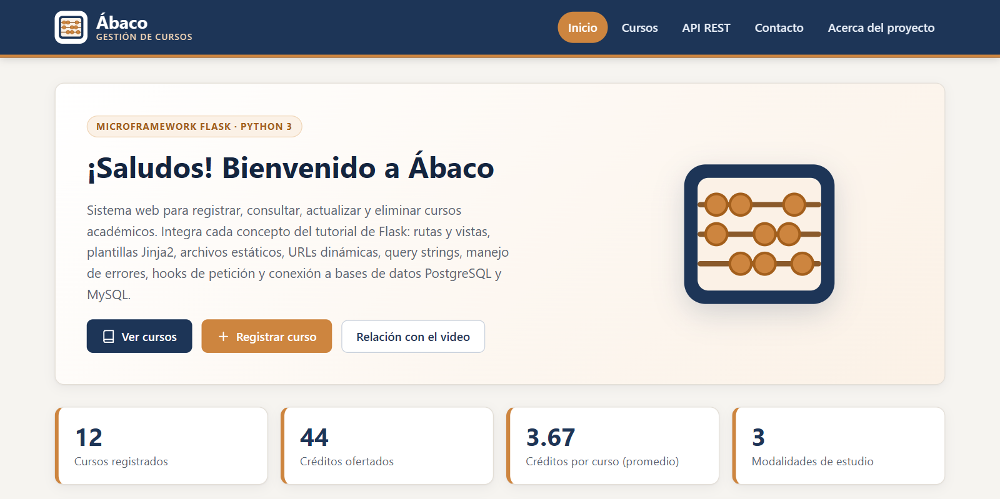
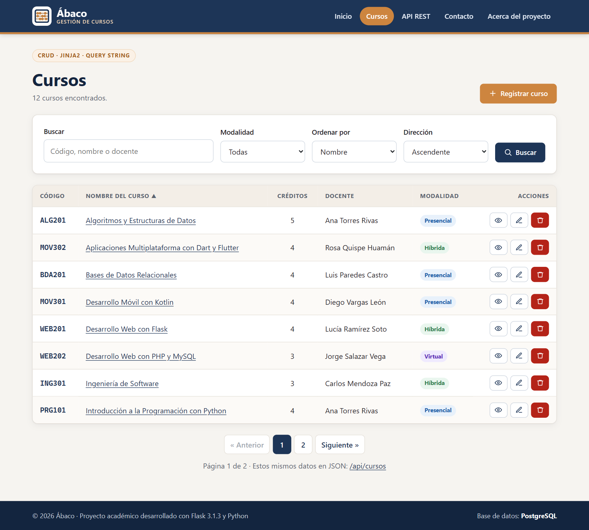
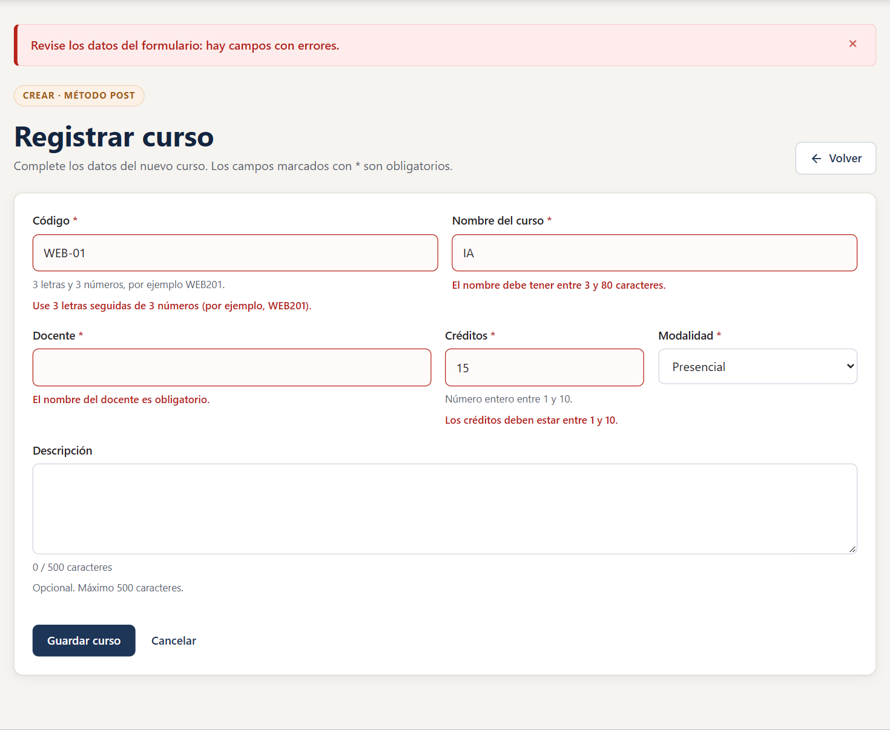
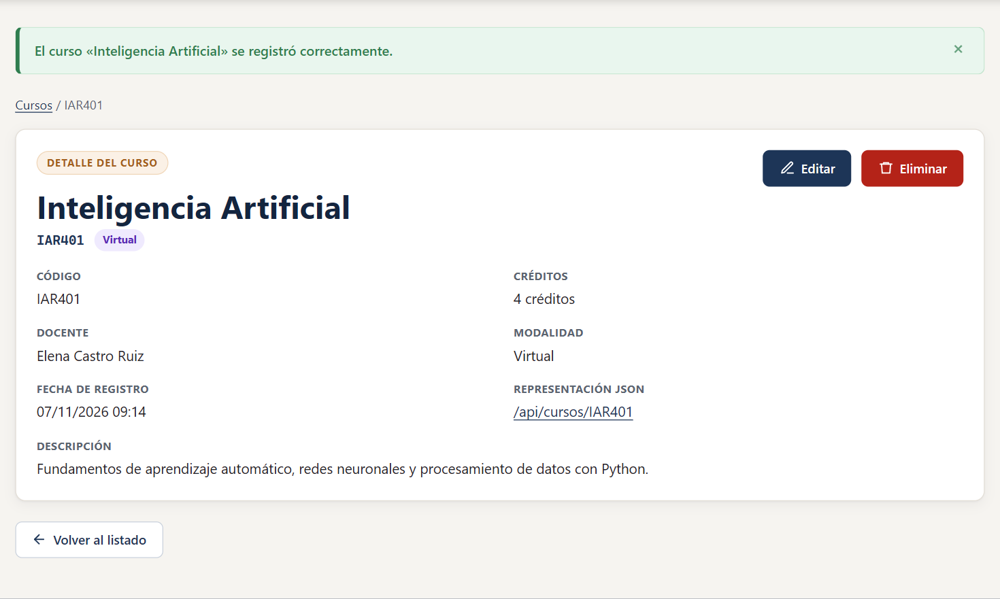
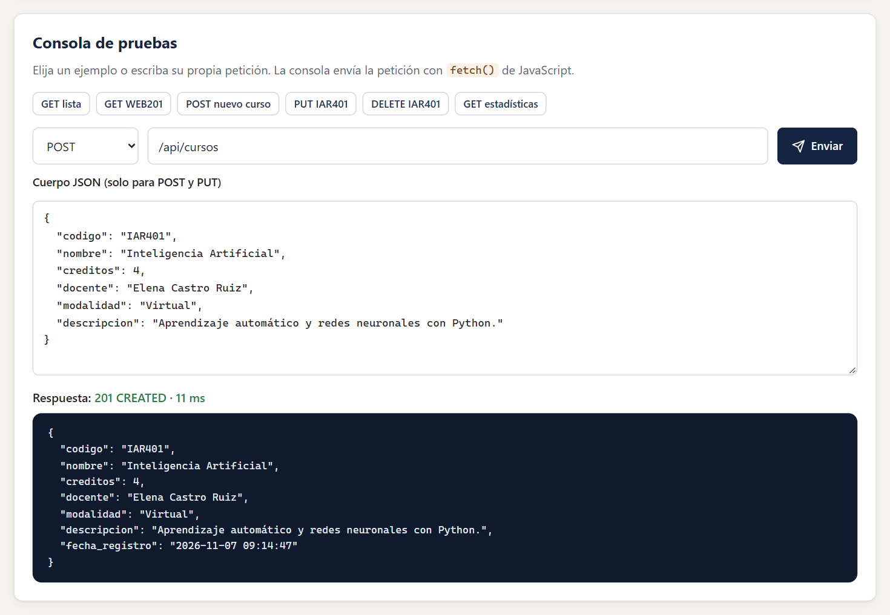
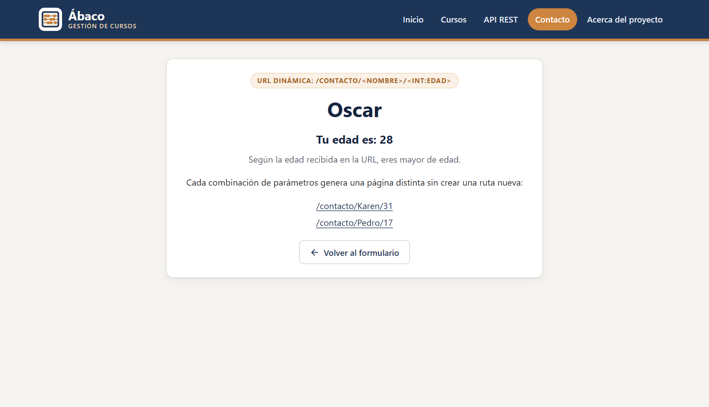
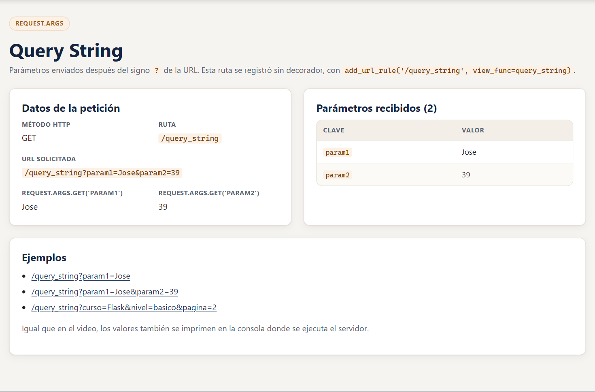
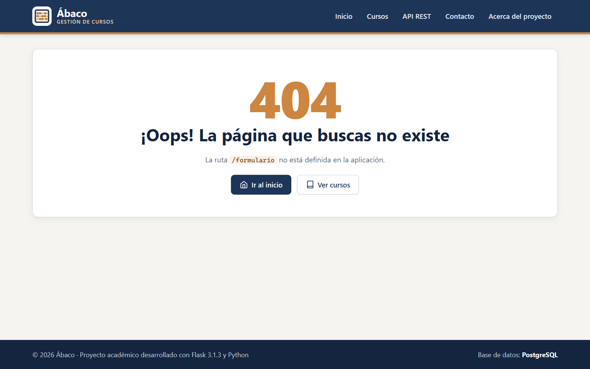
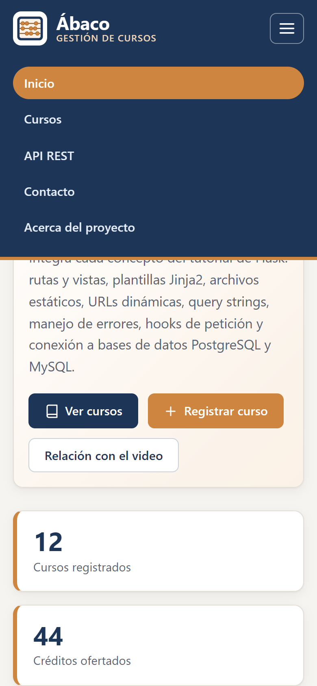

# Ábaco · Sistema de Gestión de Cursos con Flask y PostgreSQL

Aplicación web desarrollada con **Flask**, el microframework de Python, a partir del video
[«Tutorial Flask: Framework de Python para Aplicaciones Web (Desde Cero)»](https://www.youtube.com/watch?v=-1DmVCPB6H8)
del canal UskoKruM2010 (2021).

El proyecto reproduce **todos los temas del video** (entorno virtual, rutas y vistas, modo de depuración,
plantillas Jinja2, herencia de plantillas, archivos estáticos, URLs dinámicas, query string, error 404,
redirecciones, `before_request`/`after_request`, conexión a MySQL y respuestas JSON) y los amplía hasta
construir un sistema completo de gestión de cursos que usa **PostgreSQL** como base de datos principal
(base `Tarea_Flask`, administrada con pgAdmin 4), con CRUD, API REST, formularios validados con protección
CSRF, búsqueda, ordenamiento, paginación, diseño adaptable y 62 pruebas automatizadas.



---

## Tabla de contenidos

1. [Características](#1-características)
2. [Relación con el video tutorial](#2-relación-con-el-video-tutorial)
3. [Tecnologías y versiones exactas](#3-tecnologías-y-versiones-exactas)
4. [Requisitos previos](#4-requisitos-previos)
5. [Estructura del proyecto](#5-estructura-del-proyecto)
6. [Instalación paso a paso](#6-instalación-paso-a-paso)
7. [Configuración de la base de datos](#7-configuración-de-la-base-de-datos)
8. [Ejecución de la aplicación](#8-ejecución-de-la-aplicación)
9. [Rutas de la aplicación](#9-rutas-de-la-aplicación)
10. [API REST](#10-api-rest)
11. [Pruebas automatizadas](#11-pruebas-automatizadas)
12. [Solución de problemas](#12-solución-de-problemas)
13. [Capturas de pantalla](#13-capturas-de-pantalla)
14. [Créditos y referencias](#14-créditos-y-referencias)

---

## 1. Características

| Área | Funcionalidad |
|---|---|
| Video tutorial | Vista `index` con diccionario `data`, bucle `for` e `if/else` de Jinja2, plantilla base `layout.html`, CSS y JS con `url_for`, ruta `/contacto/<nombre>/<int:edad>`, `/query_string` registrada con `add_url_rule`, error 404 con `register_error_handler`, redirección con `redirect(url_for(...))`, hooks `before_request`/`after_request` y `/cursos` en JSON desde la base de datos. |
| Base de datos | **PostgreSQL** (principal, base `Tarea_Flask`) con el conector psycopg y un *pool* de conexiones; **MySQL/MariaDB** con Flask-MySQLdb, igual que en el video, o **SQLite** sin instalar nada. Se elige con `DB_MOTOR` en el archivo `.env`. |
| CRUD web | Registrar, listar, ver, editar y eliminar cursos con plantillas Jinja2 y mensajes *flash*. |
| Consultas | Búsqueda por código, nombre o docente (sin distinguir mayúsculas); filtro por modalidad; orden por columnas; paginación (todo mediante *query string*). |
| Formularios | Flask-WTF/WTForms con validación en el servidor, mensajes en español y token **CSRF**. |
| API REST | `GET`, `POST`, `PUT` y `DELETE` sobre `/api/cursos` con códigos HTTP correctos (200, 201, 400, 404, 409, 422) y una consola de pruebas en el navegador. |
| Arquitectura | Fábrica de aplicaciones (`create_app`), *blueprints*, patrón MVC, configuración por entornos y variables de entorno. |
| Seguridad | Consultas parametrizadas (anti inyección SQL), autoescape de Jinja2 (anti XSS), CSRF, eliminación solo por POST y cabeceras de seguridad. |
| Calidad | 62 pruebas con pytest: 53 con SQLite, 5 de integración con PostgreSQL y 4 con MySQL. |
| Interfaz | CSS propio, sin dependencias externas, diseño adaptable a teléfonos y tabletas. |
| Producción | Punto de entrada `wsgi.py` para el servidor WSGI **Waitress**. |

## 2. Relación con el video tutorial

| Minuto | Tema del video | Dónde se aplica en el proyecto |
|---|---|---|
| 1:13 | Creación de entorno virtual | Sección [6.2](#62-crear-el-entorno-virtual) de este documento |
| 2:32 | Instalación de Flask | `requirements.txt` con versiones exactas |
| 3:27 | Primera aplicación web | `app/app.py` → `Flask(__name__)` y `app.run()` |
| 5:30 | Rutas y vistas | `app/rutas/principal.py` → `@principal_bp.route('/')` |
| 7:45 | Modo de depuración | `app.run(debug=True, port=5000)` |
| 9:11 | Respuesta HTML | Vista `index` (línea comentada con el HTML directo del video) |
| 10:28 | Plantillas | Carpeta `app/templates` y `render_template()` |
| 12:19 | Contenido HTML dinámico | Diccionario `data` enviado a `index.html` |
| 13:24 | Motor de plantillas Jinja2 | `{{ data.bienvenida }}`, filtros `creditos` y `fecha`, macros |
| 15:32 | Iteración de listas | `` y `` |
| 18:15 | Herencia de plantillas | `layout.html` con `` y `` |
| 22:04 | Archivos estáticos | `static/css/layout.css` (color *peru*) y `static/js/layout.js` |
| 25:40 | URLs dinámicas | `/contacto/<nombre>/<int:edad>` |
| 29:53 | Query String | `/query_string?param1=Jose&param2=39` con `request.args` |
| 34:35 | 404 Not Found | `app.register_error_handler(404, pagina_no_encontrada)` y `404.html` |
| 37:50 | Redirecciones | `/inicio` y patrón Post/Redirect/Get de los formularios |
| 39:13 | before_request, after_request | Registro de cada petición y cabecera `X-Tiempo-Respuesta` |
| 40:54 | Conexión a MySQL | `app/database.py`: Flask-MySQLdb como en el video y **PostgreSQL** con psycopg (motor principal) |
| 44:41 | Respuesta JSON | `/cursos` (igual que el video) y API REST `/api/cursos` |

La página **Acerca del proyecto** (`/acerca`) muestra esta misma tabla con enlaces a cada demostración.

## 3. Tecnologías y versiones exactas

Probado con **Python 3.12.10** en **Windows 11**, con **PostgreSQL 18.2** y **pgAdmin 4**, y con
**MariaDB 10.4.32** (la versión incluida en XAMPP).

| Paquete | Versión | Uso en el proyecto |
|---|---|---|
| Flask | 3.1.3 | Microframework web |
| Werkzeug | 3.1.9 | Servidor de desarrollo, enrutamiento y utilidades WSGI |
| Jinja2 | 3.1.6 | Motor de plantillas |
| MarkupSafe | 3.0.3 | Escape seguro de HTML para Jinja2 |
| itsdangerous | 2.2.0 | Firma de la cookie de sesión |
| click | 8.5.0 | Comandos de consola (`flask run`, `flask init-db`) |
| blinker | 1.9.0 | Señales internas de Flask |
| colorama | 0.4.6 | Colores en la consola de Windows (dependencia de click) |
| psycopg | 3.3.6 | Conector de PostgreSQL para Python |
| psycopg-binary | 3.3.6 | Versión compilada de psycopg (incluye libpq; no requiere compilar) |
| psycopg-pool | 3.3.2 | *Pool* de conexiones reutilizables a PostgreSQL |
| typing_extensions | 4.16.0 | Dependencia de psycopg en Python < 3.13 |
| tzdata | 2026.5 | Zonas horarias para psycopg en Windows |
| Flask-MySQLdb | 2.0.0 | Conexión a MySQL/MariaDB (la misma extensión del video) |
| mysqlclient | 2.2.8 | Conector MySQL para Python (incluye binarios para Windows) |
| Flask-WTF | 1.3.0 | Formularios y protección CSRF |
| WTForms | 3.2.2 | Campos y validadores de formularios |
| python-dotenv | 1.2.2 | Lectura del archivo `.env` |
| waitress | 3.0.2 | Servidor WSGI para producción |
| pytest | 9.1.1 | Pruebas automatizadas (en `requirements-dev.txt`) |

> Requisito mínimo: **Python 3.10 o superior** (click 8.5, Flask-WTF 1.3 y psycopg 3.3 no admiten versiones anteriores).

## 4. Requisitos previos

- **Python 3.10+** con `pip`. Al instalarlo en Windows, marque la opción *Add python.exe to PATH*.
  Compruebe con `python --version`.
- **PostgreSQL 13 o superior** (probado con 18.2) y **pgAdmin 4**, que se instala junto con PostgreSQL.
  Debe conocer la contraseña del usuario `postgres` que definió durante la instalación.
- **Visual Studio Code** (opcional, es el editor usado en el video).
- **XAMPP** con MySQL/MariaDB (opcional, solo si desea usar MySQL como en el video).
- Un navegador web actualizado.

## 5. Estructura del proyecto

```text
gestion_cursos_flask/
├── app/                          # Código de la aplicación (como la carpeta «app» del video)
│   ├── app.py                    # Punto de entrada: create_app(), hooks, errores y app.run()
│   ├── config.py                 # Configuración por entornos (desarrollo, pruebas, producción)
│   ├── database.py               # Conexión a PostgreSQL (psycopg + pool), MySQL (Flask-MySQLdb) o SQLite
│   ├── formularios.py            # Formularios Flask-WTF con sus validaciones
│   ├── modelos/
│   │   └── curso.py              # Modelo Curso: todas las consultas SQL (CRUD y estadísticas)
│   ├── rutas/                    # Controladores organizados en blueprints
│   │   ├── principal.py          # Rutas del video: /, /contacto, /query_string, /cursos, /inicio
│   │   ├── cursos.py             # CRUD web en /gestion/cursos
│   │   └── api.py                # API REST en /api
│   ├── templates/                # Plantillas Jinja2
│   │   ├── layout.html           # Plantilla base (herencia)
│   │   ├── macros.html           # Macros reutilizables (campos, íconos, insignias)
│   │   ├── index.html, contacto.html, contacto_formulario.html, query_string.html
│   │   ├── 404.html, error.html, acerca.html
│   │   ├── cursos/               # listar.html, formulario.html, detalle.html
│   │   └── api/                  # documentacion.html
│   └── static/                   # Archivos estáticos
│       ├── css/layout.css
│       ├── js/layout.js, js/api.js
│       └── img/logo.svg, img/favicon.svg
├── database/
│   ├── abaco_postgresql.sql      # Script para PostgreSQL (base Tarea_Flask, pgAdmin)
│   ├── abaco_mysql.sql           # Script para MySQL/MariaDB (phpMyAdmin, como en el video)
│   └── abaco_sqlite.sql          # Script para SQLite (se ejecuta solo)
├── docs/capturas/                # Capturas de pantalla de la aplicación
├── tests/                        # Pruebas automatizadas con pytest
├── .env.example                  # Plantilla de variables de entorno
├── requirements.txt              # Dependencias con versiones exactas
├── requirements-dev.txt          # Dependencias + herramientas de pruebas
├── pytest.ini                    # Configuración de pytest
├── wsgi.py                       # Punto de entrada para Waitress (producción)
└── README.md                     # Este documento
```

## 6. Instalación paso a paso

> **Importante:** todos los comandos se ejecutan dentro de la carpeta **`gestion_cursos_flask`**, que es la
> que contiene `requirements.txt` y la carpeta `app`. Si abre la terminal en la carpeta superior
> (por ejemplo, `TAREA FLASK`), primero entre al proyecto con `cd gestion_cursos_flask`; de lo contrario
> aparecerán los errores `Could not open requirements file` y `can't open file ...\app\app.py`.

### 6.1. Obtener el proyecto

Descomprima el archivo del proyecto, abra la carpeta en VS Code (*Archivo → Abrir carpeta*) y en la terminal
ubíquese dentro del proyecto:

```bash
cd gestion_cursos_flask
```

### 6.2. Crear el entorno virtual

Opción recomendada (módulo `venv`, incluido en Python):

```bash
python -m venv env
```

Opción usada en el video (`virtualenv`):

```bash
pip install virtualenv
virtualenv -p python3 env
```

### 6.3. Activar el entorno virtual

| Sistema / terminal | Comando |
|---|---|
| Windows – PowerShell | `.\env\Scripts\Activate.ps1` |
| Windows – CMD | `env\Scripts\activate` |
| Windows – Git Bash | `source env/Scripts/activate` |
| Linux / macOS | `source env/bin/activate` |

Al activarlo, el indicador de la terminal mostrará `(env)`. Para salir del entorno: `deactivate`.

### 6.4. Instalar las dependencias

```bash
python -m pip install --upgrade pip
pip install -r requirements.txt
pip list
```

Para ejecutar también las pruebas automatizadas instale `requirements-dev.txt` (incluye lo anterior):

```bash
pip install -r requirements-dev.txt
```

### 6.5. Configurar las variables de entorno

Copie la plantilla `.env.example` con el nombre `.env` (si el archivo `.env` ya existe, solo edítelo):

```bash
# Windows
copy .env.example .env
# Linux / macOS
cp .env.example .env
```

Abra `.env` y escriba la contraseña del usuario `postgres` en `POSTGRES_PASSWORD`. Variables disponibles:

| Variable | Valor por defecto | Descripción |
|---|---|---|
| `SECRET_KEY` | clave de desarrollo | Firma la sesión y los tokens CSRF. Genere una con `python -c "import secrets; print(secrets.token_hex(32))"` |
| `DB_MOTOR` | `postgresql` en `.env.example` | `postgresql`, `mysql` o `sqlite` |
| `POSTGRES_HOST` | `localhost` | Servidor PostgreSQL |
| `POSTGRES_PORT` | `5432` | Puerto de PostgreSQL |
| `POSTGRES_USER` | `postgres` | Usuario de PostgreSQL |
| `POSTGRES_PASSWORD` | *(vacío)* | **Contraseña del usuario `postgres`** (la misma que pide pgAdmin) |
| `POSTGRES_DB` | `Tarea_Flask` | Nombre de la base de datos (respeta mayúsculas y minúsculas) |
| `MYSQL_HOST`, `MYSQL_PORT`, `MYSQL_USER`, `MYSQL_PASSWORD`, `MYSQL_DB` | `127.0.0.1`, `3306`, `root`, *(vacío)*, `abaco` | Conexión a MySQL (solo con `DB_MOTOR=mysql`) |
| `CURSOS_POR_PAGINA` | `8` | Filas por página en el listado |

> Si no existe el archivo `.env`, la aplicación funciona con SQLite y los valores por defecto.

## 7. Configuración de la base de datos

### 7.1. PostgreSQL con pgAdmin 4 (motor principal)

1. Verifique que el servicio de PostgreSQL esté iniciado (en Windows: `services.msc` → `postgresql-x64-18` → *En ejecución*).
2. Abra **pgAdmin 4**, conéctese al servidor con la contraseña de `postgres` y cree la base de datos:
   clic derecho en **Databases → Create → Database…**, nombre **`Tarea_Flask`** → *Save*.
   (Si la base no existe, la aplicación también intenta crearla automáticamente).
3. En el archivo `.env` deje `DB_MOTOR=postgresql`, `POSTGRES_DB=Tarea_Flask` y escriba su contraseña en
   `POSTGRES_PASSWORD`.
4. Cree la tabla y los datos de ejemplo con **cualquiera** de estas opciones:
   - **Automática:** al ejecutar `python app/app.py`, si la tabla `curso` no existe, la aplicación la crea con
     12 cursos de ejemplo. En la consola aparecerá: `Se creó la tabla «curso» con 12 cursos de ejemplo en PostgreSQL (Tarea_Flask).`
   - **pgAdmin:** clic derecho en `Tarea_Flask` → **Query Tool** → abrir `database/abaco_postgresql.sql` → **F5**.
   - **Consola:** `flask --app app/app.py init-db` o `psql -U postgres -d Tarea_Flask -f database/abaco_postgresql.sql`.
5. Compruebe los datos en pgAdmin (Query Tool), igual que el autor del video lo hace en phpMyAdmin:

   ```sql
   SELECT codigo, nombre, creditos FROM curso ORDER BY nombre ASC;
   ```

El pie de página de la aplicación mostrará **Base de datos: PostgreSQL**. La conexión utiliza un *pool* de
conexiones reutilizables (psycopg-pool), lo que reduce el tiempo de cada petición de unos 59 ms a unos 5 ms.

### 7.2. MySQL / MariaDB con XAMPP (como en el video)

1. Abra el **XAMPP Control Panel** y pulse **Start** en *Apache* y en *MySQL*.
2. Ingrese a **phpMyAdmin**: <http://localhost/phpmyadmin>.
3. Pestaña **Importar** → `database/abaco_mysql.sql` → **Importar** (crea la base `abaco` con la tabla `curso`).
4. En `.env` cambie a `DB_MOTOR=mysql` y revise `MYSQL_USER`, `MYSQL_PASSWORD` y `MYSQL_DB`.

### 7.3. SQLite (sin instalación)

Con `DB_MOTOR=sqlite` (o sin archivo `.env`), la primera ejecución crea `instance/abaco.db` con la tabla
`curso` y 12 cursos de ejemplo a partir de `database/abaco_sqlite.sql`.

### 7.4. Reiniciar los datos de ejemplo

Con el entorno virtual activado (funciona con los tres motores):

```bash
flask --app app/app.py init-db
```

> Atención: este comando **borra** la tabla `curso` y vuelve a cargar los 12 cursos de ejemplo.

Puede comprobar la conexión abriendo <http://127.0.0.1:5000/cursos>: debe responder con los cursos en JSON y
`"mensaje": "Éxito"`, igual que en el minuto 46:57 del video.

## 8. Ejecución de la aplicación

### 8.1. Igual que en el video

Desde la carpeta `gestion_cursos_flask`, con el entorno virtual activado:

```bash
python app/app.py
```

Abra <http://127.0.0.1:5000> en el navegador. El modo de depuración está activo: al guardar un archivo de
código **o el archivo `.env`** (por ejemplo, después de escribir la contraseña de PostgreSQL), el servidor se
reinicia solo con los valores nuevos. Para detenerlo pulse `Ctrl + C`.

En la consola verá cada petición registrada por los hooks del video, por ejemplo:

```text
[2026-11-07 09:14:41,813] INFO in app: Antes de la petición: GET /query_string?param1=Jose&param2=39
<Request 'http://127.0.0.1:5000/query_string?param1=Jose&param2=39' [GET]>
ImmutableMultiDict([('param1', 'Jose'), ('param2', '39')])
Jose
39
[2026-11-07 09:14:41,821] INFO in app: Después de la petición: GET /query_string -> 200 (8.40 ms)
```

### 8.2. Con la interfaz de línea de comandos de Flask

```bash
flask --app app/app.py run --debug
flask --app app/app.py routes        # lista todas las rutas registradas
```

### 8.3. En modo producción con Waitress

```bash
waitress-serve --listen=127.0.0.1:8000 wsgi:app
```

Defina antes una `SECRET_KEY` propia en el archivo `.env`. La aplicación quedará disponible en
<http://127.0.0.1:8000>.

## 9. Rutas de la aplicación

| Método | Ruta | Descripción |
|---|---|---|
| GET | `/` | Inicio: bienvenida, lista del video (`for`/`if`), indicadores y cursos recientes |
| GET | `/inicio` | Redirige a `/` (ejemplo de `redirect`) |
| GET, POST | `/contacto` | Formulario que construye la URL dinámica |
| GET | `/contacto/<nombre>/<int:edad>` | URL dinámica del video |
| GET | `/query_string` | Lectura de parámetros (`?param1=Jose&param2=39`) |
| GET | `/cursos` | JSON del video: código, nombre y créditos |
| GET | `/acerca` | Relación entre capítulos del video y el proyecto; versiones instaladas |
| GET | `/gestion/cursos/` | Tabla de cursos (`?q=`, `?modalidad=`, `?orden=`, `?dir=`, `?pagina=`) |
| GET, POST | `/gestion/cursos/nuevo` | Registrar curso |
| GET | `/gestion/cursos/<codigo>` | Detalle de un curso |
| GET, POST | `/gestion/cursos/<codigo>/editar` | Editar curso |
| POST | `/gestion/cursos/<codigo>/eliminar` | Eliminar curso |
| GET | `/api/` | Documentación y consola de pruebas de la API |

## 10. API REST

| Método | Ruta | Respuesta |
|---|---|---|
| GET | `/api/cursos` | `200` con `{"total": n, "cursos": [...]}`. Filtros: `q`, `modalidad`, `orden`, `dir` |
| GET | `/api/cursos/<codigo>` | `200` con el curso o `404` |
| POST | `/api/cursos` | `201 Created` + cabecera `Location`; `400` (JSON inválido), `409` (código repetido), `422` (validación) |
| PUT | `/api/cursos/<codigo>` | `200` con el curso actualizado; `404` o `422` |
| DELETE | `/api/cursos/<codigo>` | `200` o `404` |
| GET | `/api/estadisticas` | Totales y distribución por modalidad |

Ejemplos en **PowerShell**:

```powershell
Invoke-RestMethod http://127.0.0.1:5000/api/cursos/WEB201

$curso = @{ codigo = "IAR401"; nombre = "Inteligencia Artificial"; creditos = 4;
            docente = "Elena Castro Ruiz"; modalidad = "Virtual" } | ConvertTo-Json
Invoke-RestMethod -Method Post -Uri http://127.0.0.1:5000/api/cursos -Body $curso -ContentType "application/json; charset=utf-8"

Invoke-RestMethod -Method Delete -Uri http://127.0.0.1:5000/api/cursos/IAR401
```

Ejemplos con **curl** (Linux, macOS o `curl.exe` en Windows):

```bash
curl http://127.0.0.1:5000/api/cursos?q=web
curl -X POST http://127.0.0.1:5000/api/cursos -H "Content-Type: application/json" \
     -d '{"codigo":"IAR401","nombre":"Inteligencia Artificial","creditos":4,"docente":"Elena Castro Ruiz","modalidad":"Virtual"}'
curl -X PUT http://127.0.0.1:5000/api/cursos/IAR401 -H "Content-Type: application/json" \
     -d '{"nombre":"Inteligencia Artificial Aplicada","creditos":5,"docente":"Elena Castro Ruiz","modalidad":"Híbrida"}'
curl -X DELETE http://127.0.0.1:5000/api/cursos/IAR401
```

También puede probar todos los verbos desde el navegador en <http://127.0.0.1:5000/api/>.

## 11. Pruebas automatizadas

```bash
pip install -r requirements-dev.txt
python -m pytest -v
```

Resultado esperado: **53 pruebas aprobadas y 9 omitidas** (las 9 omitidas son las de integración con
PostgreSQL y MySQL, que se activan aparte). Cada prueba usa una base SQLite temporal, por lo que no modifica
sus datos.

Pruebas de integración con **PostgreSQL** (usan las credenciales `POSTGRES_*` del `.env` y una base aparte
llamada `tarea_flask_pruebas`, que se crea y se elimina automáticamente; la base `Tarea_Flask` no se toca):

```powershell
# PowerShell
$env:PRUEBAS_POSTGRESQL = "1"; python -m pytest -m postgresql -v
```

Pruebas de integración con **MySQL/MariaDB** (base aparte `abaco_pruebas`):

```powershell
# PowerShell
$env:PRUEBAS_MYSQL = "1"; python -m pytest -m mysql -v
```

En Linux/macOS use `PRUEBAS_POSTGRESQL=1 python -m pytest -m postgresql -v` (y lo mismo con `PRUEBAS_MYSQL`).

| Archivo | Qué comprueba |
|---|---|
| `tests/test_principal.py` | Plantillas, herencia, estáticos, URL dinámica, query string, 404, redirección, hooks y JSON del video |
| `tests/test_cursos.py` | Listado, búsqueda, filtros, orden, paginación, crear/editar/eliminar, validaciones, XSS y CSRF |
| `tests/test_api.py` | GET, POST, PUT y DELETE de la API con sus códigos de estado |
| `tests/test_postgresql.py` | Integración real con PostgreSQL: JSON del video, CRUD, estadísticas, páginas y búsqueda con ILIKE |
| `tests/test_mysql.py` | Integración real con MySQL/MariaDB |

## 12. Solución de problemas

| Problema | Solución |
|---|---|
| `ERROR: Could not open requirements file: [Errno 2] No such file or directory: 'requirements.txt'` | La terminal está en la carpeta equivocada (por ejemplo, `TAREA FLASK`). Entre al proyecto con `cd gestion_cursos_flask` y repita el comando. |
| `can't open file '...\TAREA FLASK\app\app.py': [Errno 2] No such file or directory` | Mismo motivo: la carpeta `app` está dentro de `gestion_cursos_flask`. Ejecute `cd gestion_cursos_flask` y luego `python app/app.py`. |
| Consola: `No se pudo conectar con PostgreSQL. La contraseña no es correcta o está vacía` (`fe_sendauth: no password supplied` o `la autentificación password falló`) | Escriba en `POSTGRES_PASSWORD` del archivo `.env` la contraseña del usuario `postgres` (la que usa en pgAdmin) y reinicie la aplicación. |
| `database "Tarea_Flask" does not exist` | Cree la base en pgAdmin con ese nombre exacto (PostgreSQL distingue mayúsculas) o corrija `POSTGRES_DB`. |
| `connection refused` / no responde el puerto 5432 | Inicie el servicio de PostgreSQL en `services.msc` o revise `POSTGRES_HOST` y `POSTGRES_PORT`. |
| La página muestra «Base de datos no disponible» (código 503) | La página indica la causa exacta (contraseña vacía o incorrecta, base inexistente o servicio detenido). Corrija el `.env` y guárdelo: con `python app/app.py` el servidor se reinicia solo al guardar el `.env`; después recargue la página. Si inició la aplicación de otra forma (por ejemplo, `flask run`), deténgala con `Ctrl + C` y vuelva a iniciarla. |
| PowerShell no permite activar el entorno («la ejecución de scripts está deshabilitada») | Ejecute una vez `Set-ExecutionPolicy -ExecutionPolicy RemoteSigned -Scope CurrentUser` o use CMD con `env\Scripts\activate`. |
| `python` no se reconoce como comando | Reinstale Python marcando *Add python.exe to PATH* o use `py` en lugar de `python`. |
| `ModuleNotFoundError: No module named 'flask'` (o `psycopg`) | El entorno virtual no está activado o faltan dependencias: active `env` y ejecute `pip install -r requirements.txt` dentro de `gestion_cursos_flask`. |
| `[notice] A new release of pip is available` | Es solo un aviso, no un error. Puede actualizar pip con `python -m pip install --upgrade pip`. |
| Error al instalar `mysqlclient` en Linux | `sudo apt install python3-dev default-libmysqlclient-dev build-essential pkg-config` y repita la instalación. En macOS: `brew install mysql pkg-config`. |
| XAMPP no inicia MySQL: puerto 3306 ocupado | Otro servicio MySQL/MariaDB usa el puerto. Deténgalo en `services.msc` o cambie el puerto en XAMPP y ajuste `MYSQL_PORT`. |
| Cada página tarda unos 2 segundos con MySQL | Use `MYSQL_HOST=127.0.0.1` en lugar de `localhost` (Windows intenta primero IPv6). |
| El puerto 5000 está ocupado | Cambie el puerto en `app.run(debug=True, port=5001)` o use `flask --app app/app.py run --port 5001`. |
| «El token de seguridad del formulario no es válido o expiró» | La página estuvo abierta mucho tiempo o cambió la `SECRET_KEY`: recargue la página y vuelva a enviar. |
| Los estilos no se actualizan | Recargue sin caché con `Ctrl + F5` o `Ctrl + Shift + R` (consejo del video). |

## 13. Capturas de pantalla

| Listado de cursos (PostgreSQL) | Formulario con validaciones |
|---|---|
|  |  |

| Detalle y mensaje flash | Consola de la API REST |
|---|---|
|  |  |

| URL dinámica | Query string |
|---|---|
|  |  |

| Error 404 personalizado | Diseño adaptable |
|---|---|
|  |  |

## 14. Créditos y referencias

- UskoKruM2010. (2021, 14 de junio). *Tutorial Flask: Framework de Python para aplicaciones web (desde cero)*
  [Video]. YouTube. https://www.youtube.com/watch?v=-1DmVCPB6H8
- Pallets. (2026). *Flask documentation (3.1.x)*. https://flask.palletsprojects.com/
- Pallets. (2025). *Jinja documentation (3.1.x)*. https://jinja.palletsprojects.com/
- PostgreSQL Global Development Group. (2026). *PostgreSQL 18 documentation*. https://www.postgresql.org/docs/18/
- Psycopg Team. (2026). *Psycopg 3 documentation (3.3)*. https://www.psycopg.org/psycopg3/docs/
- Flask-MySQLdb. (2023). *Flask-MySQLdb documentation*. https://flask-mysqldb.readthedocs.io/
- WTForms. (2026). *Flask-WTF documentation*. https://flask-wtf.readthedocs.io/

Proyecto académico desarrollado en grupo para la asignatura correspondiente. Los nombres de los docentes y
cursos de los datos de ejemplo son ficticios.
